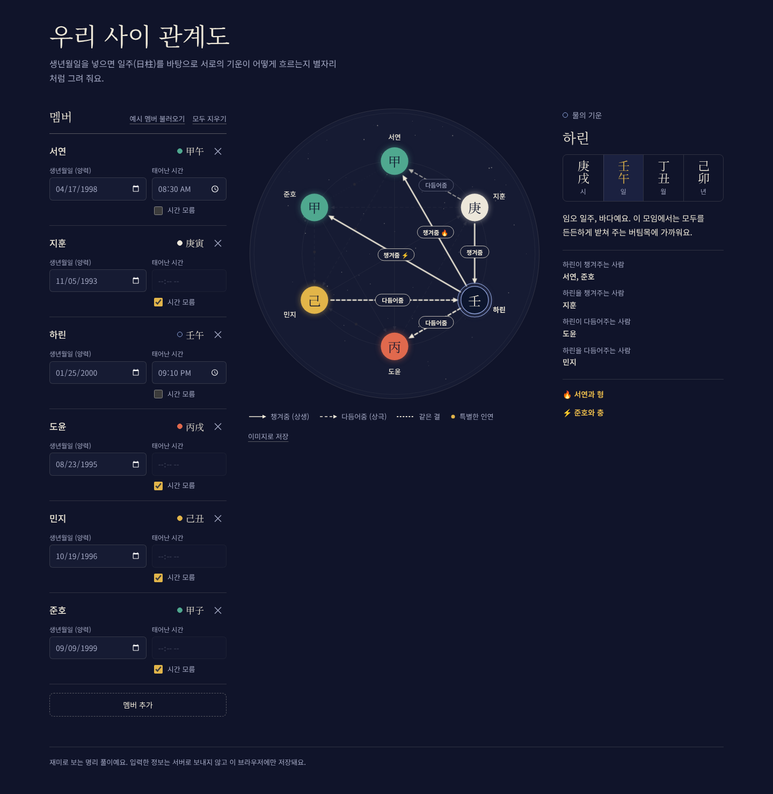
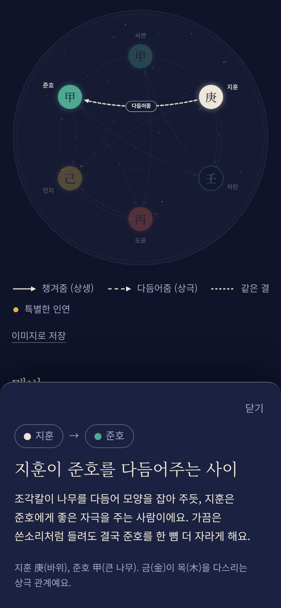

# 우리 사이 관계도 (Saju Chemi)

🔗 **https://saju-chemi-app.vercel.app**

바로 써 보기: 위 주소에서 "예시 멤버 불러오기"를 누르면 관계도가 그려져요.\
Try it now: open the link above and press "예시 멤버 불러오기" (load sample members) to see a graph.

여러 사람의 생년월일을 넣으면 일주(日柱)를 바탕으로 서로의 관계를 별자리처럼 그려 주는 웹앱이에요.\
Enter several people's birth dates and it draws how they relate as a constellation, based on each person's day pillar (日柱).

재미로 보는 명리 풀이이며, 실제 관계를 판단하는 근거로 쓰지 않아요.\
It's a just-for-fun reading of Korean saju (Four Pillars), not a basis for judging real relationships.

## 스크린샷 / Screenshots

<table>
  <tr>
    <td valign="top" width="68%">
      
    </td>
    <td valign="top" width="32%">
      
    </td>
  </tr>
  <tr>
    <td valign="top">
      사람을 누르면 그 사람과 연결된 선이 굵어지고, 사주 네 기둥과 모임 속 흐름을 보여 줘요.<br />
      Selecting a person thickens all of their lines and shows their four pillars and role in the group.
    </td>
    <td valign="top">
      모바일에서는 선을 탭하면 풀이가 바텀시트로 올라와요.<br />
      On mobile, tapping a line slides the reading up in a bottom sheet.
    </td>
  </tr>
</table>

스크린샷 속 이름과 생년월일은 모두 예시용으로 지어낸 데이터예요.\
All names and birth dates in the screenshots are made-up sample data.

## 주요 기능 / Features

- 선은 기본으로 얇고 흐리게 모두 그려요.\
  Every relationship line is drawn thin and faint by default.
- 마우스를 올리면 선이 한 단계 진해져서 "눌러 볼래?"라는 신호를 줘요.\
  Hovering makes a line one step bolder, hinting that it can be selected.
- 선을 누르면 굵어지고 나머지는 흐려지며, 풀이가 진하게 표시돼요.\
  Selecting a line thickens it, fades the rest, and shows its reading in bold.
- 사람을 누르면 그 사람과 연결된 선이 모두 강조되고, 모임 안에서의 흐름을 요약해 줘요.\
  Selecting a person highlights all of their lines and summarizes their flow within the group.
- 모바일은 탭 기준으로 동작하고, 풀이는 바텀시트로 올라와요.\
  On mobile everything works by tap, and the reading slides up as a bottom sheet.
- 관계도를 PNG 이미지로 저장할 수 있어요.\
  The graph can be saved as a PNG image.
- 입력한 정보는 서버로 보내지 않고 이 브라우저(localStorage)에만 저장돼요.\
  Your input never leaves the browser; it is stored only in localStorage.

## 실행 / Getting started

```bash
npm install
npm run dev      # 개발 서버 / dev server (http://localhost:5173)
npm run build    # dist/ 에 정적 파일 생성 / build static files into dist/
npm run preview  # 빌드 결과 확인 / preview the build
```

## 배포 / Deploy (Vercel)

1. vercel.com에서 Add New → Project를 누르고 이 저장소를 Import 해요.\
   On vercel.com, choose Add New → Project and import this repository.
2. Framework Preset이 Vite로 잡혔는지만 확인하고 Deploy를 눌러요.\
   Confirm the Framework Preset is Vite, then click Deploy.

환경 변수는 필요 없어요. 모든 계산은 브라우저에서 해요.\
No environment variables are needed; everything is computed in the browser.

## 관계 판정 기준 / How relations are read

두 사람의 일간(日干) 오행으로 기본 관계를 정해요.\
The base relation comes from the element (of the five) behind each person's day stem (日干).

| 관계<br>Relation | 조건<br>Condition | 선 모양<br>Line |
| --- | --- | --- |
| 챙겨줌<br>Support | A의 오행이 B를 생(生)<br>A's element generates B's | 실선 화살표 A→B<br>Solid arrow A→B |
| 다듬어줌<br>Refine | A의 오행이 B를 극(剋)<br>A's element controls B's | 파선 화살표 A→B<br>Dashed arrow A→B |
| 같은 결<br>Peer | 같은 오행<br>Same element | 점선, 화살표 없음<br>Dotted, no arrow |

특별한 인연은 선 가운데 금색 점과 풀이 속 뱃지로 표시해요. 한 쌍에는 선을 하나만 그려요.\
Special bonds appear as a gold dot on the line and as badges in the reading; each pair gets only one line.

- 🤝 천간합: 일간끼리 甲己, 乙庚, 丙辛, 丁壬, 戊癸\
  🤝 Stem combination: day stems 甲己, 乙庚, 丙辛, 丁壬, 戊癸
- 🔗 육합: 일지끼리 子丑, 寅亥, 卯戌, 辰酉, 巳申, 午未\
  🔗 Six harmonies: day branches 子丑, 寅亥, 卯戌, 辰酉, 巳申, 午未
- ⚡ 충: 일지끼리 子午, 丑未, 寅申, 卯酉, 辰戌, 巳亥\
  ⚡ Clash: day branches 子午, 丑未, 寅申, 卯酉, 辰戌, 巳亥
- 🔥 형: 寅巳申, 丑戌未, 子卯, 자형(辰辰, 午午, 酉酉, 亥亥)\
  🔥 Punishment: 寅巳申, 丑戌未, 子卯, and self-punishment (辰辰, 午午, 酉酉, 亥亥)

모든 문구는 긍정적인 톤으로 써요. 극은 "좋은 자극", 충은 "서로를 움직이게 하는 사이"로 풀어요.\
All copy keeps a positive tone: control reads as "a good push", and clash as "people who set each other in motion".

## 폴더 구조 / Project structure

```
src/
  lib/
    saju.ts          생년월일 → 사주 기둥 / birth date → four pillars (lunar-javascript)
    relations.ts     두 사람의 관계 판정과 문구 / relation rules and copy
    selection.ts     기본·hover·선택·흐림 상태 / default, hover, active, dim states
    theme.ts         오방색 팔레트와 선 모양 / five-color palette and line styles
    josa.ts          이름 뒤 조사 처리 / Korean particles after names
    storage.ts       localStorage 저장과 예시 멤버 / local storage and sample members
    exportImage.ts   관계도 PNG 저장 / export the graph as PNG
  components/
    RelationGraph.tsx  원형 별자리 그래프 (SVG) / circular constellation graph (SVG)
    DetailPanel.tsx    풀이 패널과 바텀시트 / reading panel and bottom sheet
    PeopleEditor.tsx   멤버 입력 / member input
```

## 알려진 한계 / Known limitations

- 한국 표준시에서 30분을 빼 서울 지방시에 가깝게 보정하고, 날짜는 KST 00:30에 바뀌어요.\
  Birth times are shifted 30 minutes from KST toward Seoul local time, and the date changes at 00:30 KST.
- 서머타임(1948–1951, 1955–1960, 1987–1988년 여름)은 반영하지 않아요.\
  Korean daylight saving periods (summers of 1948–1951, 1955–1960 and 1987–1988) are not applied.
- 태어난 시간을 모르면 정오 기준으로 계산하고 시주는 비워 둬요.\
  If the birth time is unknown, noon is used and the hour pillar is left empty.
- 일주 기준 관계만 보며, 삼합·원진·대운은 아직 없어요.\
  Only day-pillar relations are read; three harmonies, wonjin and luck cycles are not included yet.
- lunar-javascript 때문에 JS 번들이 약 550KB(gzip 180KB)예요.\
  The JS bundle is about 550 KB (180 KB gzipped) because of lunar-javascript.
- 이미지로 저장하면 웹폰트 대신 기기 기본 글꼴이 쓰여요.\
  Saved images use the device's default fonts instead of the web fonts.

## 다음 단계 / Next steps

- Supabase로 관계도를 저장하고 공유 링크 만들기\
  Save graphs and create share links with Supabase
- 관계도 위에 오늘의 일진을 겹쳐 오늘 기운이 센 사람 강조하기\
  Overlay today's day pillar to highlight who is in their element today
- 멤버가 많을 때 관계 종류별 필터 추가하기\
  Add relation-type filters for larger groups

## 사용한 것 / Built with

React, TypeScript, Vite, [lunar-javascript](https://github.com/6tail/lunar-javascript) (MIT)
